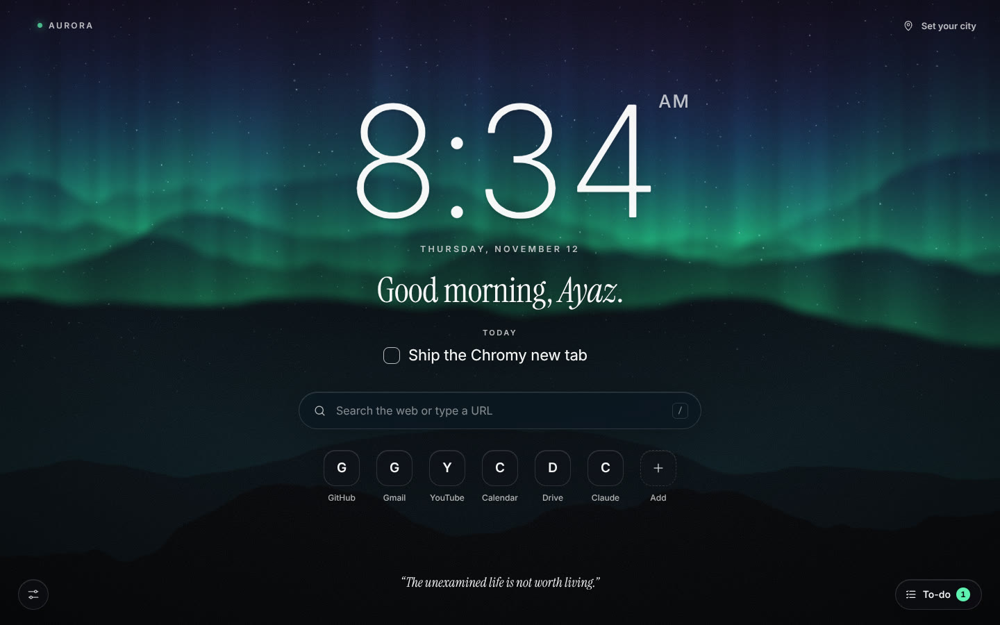

# Chromy — Live New Tab

A new tab dashboard for Chrome in the spirit of Momentum, built around looks first:
GPU-rendered live themes, your own images and videos as animated wallpapers, and a
quiet glass interface on top.

## Install

1. Open `chrome://extensions`
2. Turn on **Developer mode** (top right)
3. Click **Load unpacked** and pick this folder
4. Open a new tab

There is no build step: the folder is the extension.

## What is in it

**Live themes** — ten fragment shaders rendered in WebGL2, all reacting to the cursor.

| Theme | |
| --- | --- |
| Aurora | Northern lights over a ridge line |
| Horizon | Layered mountains whose sky, sun and moon follow your local time |
| Nebula | Slow-churning deep space clouds |
| Silk / Glacier / Obsidian | Liquid gradients in three colourways |
| City Lights | Out-of-focus lights after dark |
| Outrun | Retro sun and an endless grid |
| Warp | Drifting through a star field |
| Contour | Shifting topographic lines |

**Your own wallpapers** — add images, GIFs, MP4 or WebM from the settings panel, or drop a
file anywhere on the page. Still images can be given motion (*Breeze*, *Water*, *Dream*)
plus a slow zoom and cursor parallax. Files are kept in IndexedDB on your device.

**Effects** on top of any wallpaper — particles (snow, rain, fireflies, dust, petals),
speed, parallax, dim, blur, vignette, film grain, and a quality setting
(Battery / Balanced / Ultra). Rendering pauses whenever the tab is hidden.

**Dashboard** — clock in four styles, greeting, daily focus, search (uses Chrome's default
search engine), quick links seeded from your top sites, weather, a daily quote and a to-do list.
Every piece can be switched off.

## Shortcuts

| Key | Action |
| --- | --- |
| `/` | Focus search |
| `,` | Open or close settings |
| `[` `]` | Previous / next live theme |
| `Esc` | Close panels |

## Permissions and privacy

| Permission | Used for |
| --- | --- |
| `search` | Sending searches to your default search engine |
| `topSites` | Seeding the quick links the first time |
| `favicon` | Showing site icons on quick links |

Settings live in `localStorage`, wallpapers in IndexedDB. Nothing leaves the browser except
weather requests to [Open-Meteo](https://open-meteo.com) for the city you choose.

## Adding a theme

Themes live in `js/wallpaper/themes.js`. Write a GLSL function
`vec3 scene(vec2 uv, vec2 p)` and add an entry to `THEMES`. Available uniforms:
`u_time`, `u_res`, `u_mouse` (smoothed, -1..1) and `u_hour` (local time, 0–24).

## Credits

Fonts: Inter, Instrument Serif and JetBrains Mono, each under the SIL Open Font License
(see `assets/fonts`).
